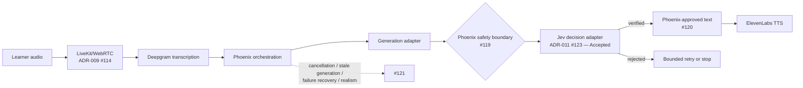

# Jev Prototype Design: Verified Dialogue and Educational Point Estimates

Status: **Accepted architecture as of 2026-09-21. Only the evaluation side owned by [#128](https://github.com/ChordanDev/proyectoMed/issues/128) is described here as implemented, as an internal backend capability with no live adapter and no HTTP exposure (2026-10-06); see [Evaluation contract](#evaluation-contract).** Every other section keeps the "accepted, not implemented" status it states. [ADR-011 (#123)](https://github.com/ChordanDev/proyectoMed/issues/123) and [ADR-012 (#124)](https://github.com/ChordanDev/proyectoMed/issues/124) are Accepted, and [Ticket 14 (#125)](https://github.com/ChordanDev/proyectoMed/issues/125) with children #126–#130 remains the implementation-planning graph. Acceptance authorizes architecture only. These records do not describe shipped Jev, learner-visible estimate, API, or UI behavior; do not activate pilot or production use; and do not select or approve a provider, accept privacy/ZDR/legal terms, establish clinical accuracy, authorize certification/pass-fail/readiness claims, or complete clinical pt-BR qualification.

## Decision summary

| Topic | Accepted architecture decision |
|---|---|
| Dialogue safety | Deterministic deny rules run first. Every non-template candidate must pass Jev before display or text-to-speech. |
| Approved reply | The only bypass is exact package/version-bound template text with deterministic applicability. Shortness, tone, or a model-provided ID never authorizes it. |
| Semantic rejection | Semantic refusal or low confidence means no delivery and permits at most one regeneration plus a complete recheck inside the turn deadline. |
| Technical failure | Jev timeout, malformed output, transport failure, or provider 5xx invalidates the attempt under existing policy. It never becomes `uncertain` and never produces fallback clinical text. |
| Evaluation split | TypeSafe outputs provide constrained classifications/probabilities. Code validates existing evidence IDs and applies authored rubric rules and decimal points. |
| Result | A complete numeric total exists only when every active criterion is assessed. Partial results show coverage and unresolved criteria without rescaling. |
| Claims | Educational estimate only: no pass/fail, official equivalence, certification, readiness claim, or published performance number. |
| Architecture | One shared Phoenix proxy/domain interface may host distinct generation, transcription, TTS, and decision-model adapters. Jev does not replace generation. |

## Current runtime and accepted architecture

| Area | Current evidence | Accepted, unimplemented change |
|---|---|---|
| Reply boundary | Closed #44 supplied the prior bounded-reply seam. Current modules remain top-level. | Add the Jev verification decision inside Phoenix while preserving #119–#121 ownership. |
| Evaluation | Closed #27 supplied the prior evaluator seam, and it still serves `GET .../result`: the learner-visible runtime follows ADR-005 (#38) and has no global score. #128 added the four-state assessment and exact estimates as an internal capability (`Backend.Stations.assess_session/2`) whose default adapter is disabled. | Expose the assessment through the versioned result contract (#129) once a qualified decision adapter and clinical qualification (#130) exist. |
| Voice | ADR-009 (#114) is **Accepted** for prototype LiveKit/WebRTC + Deepgram + ElevenLabs. Ticket 13 (#116) owns children #117–#121. | Integrate verification at the established Phoenix safety boundary; do not create another media or orchestration path. |
| Avatar | ADR-010 (#115) is **Proposed** and V3-only. | No dependency; excluded from this prototype. |
| Impressos | The #105–#108 dependency graph is unchanged. | Consume Impressos events only for criteria whose evidence requires those events. |
| Context governance | `Backend.Stations` is the public context module, with its internals under `backend/lib/backend/stations/`. | No further change from this design. |

## Dialogue safety contract

### Approved Generic Reply

An Approved Generic Reply is not “any short safe sentence.” It is one exact template whose identity and applicability are authored in a specific Station Package version.

A reply bypasses Jev only when all of these hold:

1. its text is byte-identical to the stored template;
2. the template belongs to the active `station_id` and package version;
3. code evaluates the authored applicability predicate to `true` from the current case state; and
4. the safe renderer emits the stored text without prefixes, suffixes, interpolation, or mixed content.

Length, brevity, language, sentiment, plausible tone, or a model-declared template ID never authorizes text. `"Estou bem"` is eligible only when the authored case state makes that exact statement non-contradictory. `"Não tenho alergias"` is a clinical claim, not a generic reply, and requires an authored revealable fact.

An approved template is not necessarily a clinical answer and is not a universal fallback. A deterministic known violation may route to a zero-clinical-content fallback only when that exact fallback template is approved for the violation and its applicability predicate passes. Otherwise code blocks the candidate and invalidates or ends the attempt according to the governing contract.

### Pipeline

1. **Run deny-only checks.** A known violation blocks the candidate. A clean result does not prove safety.
2. **Check exact approved-template identity and applicability.** If both pass, the safe renderer may emit the stored text.
3. **Send every other candidate to Jev.** Check groundedness, contradiction, disclosure timing, patient-role relevance, and prompt-injection evidence.
4. **Deliver only a verified result.** Rejected text never reaches the learner or ElevenLabs.

Learner turns may reach generation as untrusted evidence. A rejected or otherwise unverified patient candidate is not added to trusted conversation history or a regeneration prompt. Generation may receive package facts, untrusted learner evidence, and previously approved patient history; TTS receives only Phoenix-approved patient text.

### Outcome table

| Outcome | Delivery | Next action |
|---|---|---|
| Verified | Yes | Phoenix may display it and pass the approved text to TTS. |
| Semantic refusal | No | At most one regeneration and full verification within the total deadline; otherwise block/end under the contract. |
| Low confidence | No | Same bounded single-regeneration path as semantic refusal; never silently accept. |
| Deterministic known violation | No candidate delivery | Use an exact approved zero-clinical-content fallback only when its authored applicability passes; otherwise block/invalidate. |
| Jev timeout | No | Technical failure; invalidate the attempt under existing policy. No regeneration fallback or clinical text. |
| Malformed Jev output | No | Technical failure; invalidate the attempt. Do not convert it to `uncertain`. |
| Transport error or provider 5xx | No | Technical failure; invalidate the attempt. No partial feedback. |

The canonical patient reply `"Não tenho essa informação"` has clinical meaning: the package does not contain the requested fact. It may be used only under its exact authored applicability rule. It never masks infrastructure failure.

## Jev input and provider seams

Phoenix builds the gate request from trusted code and package data. Learner and model text are evidence fields, never instruction channels.

```json
{
  "stage_id": "verify-patient-reply",
  "request_id": "<per-candidate id>",
  "package_id": "<station_id>",
  "package_version": "<version>",
  "candidate": { "text": "<candidate>", "origin": "generation" },
  "latest_learner_turn": { "role": "learner", "seq": 42, "text": "<text>" },
  "conversation_context": [
    { "role": "learner", "seq": 1, "trust": "untrusted_evidence", "text": "<learner text>" },
    { "role": "patient", "seq": 2, "trust": "approved", "text": "<approved patient text>" }
  ],
  "allowed_facts": [
    { "fact_id": "<existing id>", "content": "<fact>", "disclosure_conditions": "<authored rule>" }
  ]
}
```

One shared Phoenix proxy/domain interface can host separate adapters for:

- patient-response generation;
- Deepgram transcription;
- ElevenLabs text-to-speech; and
- the Jev decision model.

Sharing an interface boundary does not collapse those capabilities into one adapter. Jev verifies generation output; it does not author or replace it. The public entry point is `Backend.Stations`.

Provider selection, credentials, API limits, zero-data-retention terms, legal terms, and clinical pt-BR calibration are unresolved qualification gates. Vendor statements are inputs to review, not repository validation.

## Integration with real-time voice

ADR-009 (#114) already selects LiveKit/WebRTC + Deepgram + ElevenLabs for the prototype. Issues #119–#121 are integration boundaries, not blanket blockers for every Ticket 14 child. Jev integration must extend their flow without duplicating ownership:

- **#119:** no patient response exits Phoenix before the safety boundary passes it;
- **#120:** ElevenLabs receives only text Phoenix has approved; and
- **#121:** owns cancellation, stale generation, failure recovery, and realism, without absorbing media, UI, or orchestration concerns.

Ticket 14 children own only net-new Jev, content, evaluation, result, and qualification behavior. They reference the applicable #119–#121 contracts at integration time rather than recreating them or claiming their work.



## Evaluation contract

Status of this section: **implemented by [#128](https://github.com/ChordanDev/proyectoMed/issues/128) as an internal backend capability (2026-10-06).** Nothing in it is reachable over HTTP, no live decision adapter exists, and its clinical accuracy is unmeasured. What it does not do is listed under [Limits](#limits).

| Question | Answer |
|---|---|
| Entry point | `Backend.Stations.assess_session/2`, which runs `Backend.Stations.RubricAssessment.assess/3` on a completed session and the active Station Package. |
| Success | Criterion results in rubric order, the point estimates, and the list of Jev calls made with the justification of each. |
| Failure | `{:error, {:invalid_attempt, reason}}` with no criteria at all. |
| Default behavior | The configured decision adapter is the disabled adapter, so every assessment is an invalid attempt (`adapter_disabled`) until a qualified adapter is configured. |
| Learner-facing result | Unchanged. `GET .../result` still serves the legacy evaluator's `met \| omitted \| uncertain` shape. |

### Shared evidence

Evaluation uses one evidence pool per attempt, built from the completed, immutable session and shared by every rubric question. Rubric sections group criteria for presentation; they do not partition the pool. A learner statement may support multiple criteria. Patient-role words never earn learner credit: a cited patient turn is rejected.

Evidence identifiers are derived at evaluation time. They are not stored, and the conversation and Impressos event contracts are unchanged:

| Evidence | Identifier | Channel | Provenance |
|---|---|---|---|
| Transcript turn | `turn-N`, where `N` is the 1-based position in the session `messages` | The turn's modality (`text` or `voice`) | `transcript` |
| Impressos request event | `impresso-<request_id>` | `impressos` | `impressos` when the event was recorded for the package's version and every impresso it released is authored in the package; otherwise `unverified` |

The pool is ordered by timestamp. On an exact tie, turns keep message order, events keep their `order`, and turns come before events. That order is what "earlier" and "later" mean for the first-N and task-order rules below.

Only verified items are offered to Jev, each reduced to `id`, `role`, and `text`. Unverified events stay in the pool so that citing one is rejected with a reason instead of looking like an identifier that never existed.

### TypeSafe outputs and evidence identity

TypeSafe Choice/Noul-style primitives may return only constrained classifications or probabilities. They do not make model-authored evidence IDs trustworthy. The implemented contract therefore asks only for classes and for identifiers taken from the code-supplied pool, and code validates every identifier. No probability or confidence value is read.

**One batched call.** Every question that needs Jev travels in one call, with the pool sent once. A second call happens only for a provider capacity limit (the `:max_questions_per_call` option), and every call is recorded as `single_batch` or `provider_capacity`. No call exists for a result dependency: the one rule that depends on other criteria, task order, is computed in code.

| Direction | Field | Content |
|---|---|---|
| Question | `criterion` | The criterion `id` and a description composed from the authored description, its evidence questions, and one line per level. |
| Question | `allowed_classes` | The authored level labels plus `uncertain`. |
| Question | `actions` | The authored actions (`id`, `description`); empty when none are authored. |
| Question | `enumerate_answers` | Present, and `true`, only on a criterion that authors `first_n` and at least one action. |
| Decision | `criterion_id`, `classification` | Exactly one decision per question, classified with one of that question's allowed classes. |
| Decision | `evidence_ids` | Identifiers from the pool that support the classification. |
| Decision | `rationale` | Optional text. It is accepted and not carried into the result. |
| Decision | `actions` | Exactly one entry per authored action: `performed`, `not_performed`, or `uncertain`, with its own `evidence_ids`. |
| Decision | `answers` | Required when the enumeration was requested; on any other question it must be absent or an empty list, which is dropped. The ordered list of the distinct answers the learner gave to that criterion, each `{evidence_id, action_id}`, where `action_id` is the authored action it matches or `null`. |

**Structural problems invalidate the attempt.** A missing, duplicated, or unknown criterion or action decision, a class outside the allowed set, a missing or malformed `answers` list, an answer naming an unknown action or an action already named, or a non-empty `answers` on a question that did not request it, is treated like any other technical failure. The enumeration added no adapter callback: an adapter that does not enumerate fails as it would for any missing output.

**Bad evidence fails one criterion closed.** Every cited identifier is looked up in the pool. The criterion becomes `uncertain` with a machine-readable reason, and nothing is repaired, dropped, substituted, or aligned by text:

| Rejection | Meaning |
|---|---|
| `nonexistent_evidence_id` | Not an identifier of the pool. |
| `wrong_role` | Not authored by the learner, such as a patient turn. |
| `wrong_provenance` | An unverified Impressos event. |
| `wrong_channel` | Learner evidence that does not satisfy the criterion's `modality_requirement`, or an event that released nothing. |

The same validation applies to the criterion's own citations, to each action's citations, and to each enumerated answer. Because Jev returns identifiers only, there is no model-authored excerpt to byte-match: the excerpts a result reports are read from the pool. If a provider cannot return identifiers from a code-supplied set, deterministic span alignment remains a separate, unimplemented algorithm and test surface.

### Deterministic rubric application

After classification, code—not Jev—decides the status, the level, and the points.

**Statuses.** Status is exactly `assessed | uncertain | not_observable | not_applicable`. A level (`inadequado | parcialmente_adequado | adequado`) and points exist only for `assessed`.

| Status | When | Asked to Jev | In the maxima |
|---|---|---|---|
| `assessed` | A level was decided and, when it is above zero, grounded in validated learner evidence. | Yes, except the task-order criterion | Scored and eligible |
| `uncertain` | Jev answered `uncertain` and no authored rule could decide; or cited evidence failed validation; or an unresolved action could still change the level; or the enumerated answers of a `first_n` criterion could not be verified; or a positive level had no evidence; or, for the task-order criterion, a ranked criterion is unresolved. | Yes, except the task-order criterion | Eligible only |
| `not_observable` | The criterion's `modality_requirement` names a modality the station cannot provide: an Impressos requirement with no matching authored impresso, or an unknown modality. | No | Eligible only |
| `not_applicable` | The criterion authors `exclusion: true`. | No | Neither |

A modality the station does provide but the learner never used is a genuine omission: it is assessed at the authored zero-point level when Jev classifies it so. Low confidence or missing modality is never silently scored zero.

**Authored rule fields.** All are optional additions to the v2 package schema, so existing packages stay valid. The loader rejects inconsistent combinations, each with its own message.

| Field | Meaning in code |
|---|---|
| `levels[].points` | A multiple of 0.125, converted once to integer eighths. |
| `levels[].min_actions` | Count thresholds, set on every level of a criterion or on none. The level is the highest one whose threshold is at most the number of performed, non-forbidden actions. The count decides; Jev's criterion-level class does not. |
| `actions[].role` | `counted` (default), `mandatory`, or `forbidden`. A `mandatory` action that was not performed, or a `forbidden` action that was performed with evidence, scores the criterion at its zero-point level. |
| `count_cap` | Caps the count of performed actions before thresholds are applied. |
| `first_n` | Only the learner's first N enumerated answers to the criterion are eligible, including answers that match no authored action. A criterion that authors it and at least one action must author thresholds, because a level Jev chooses as a whole cannot be limited to the first N answers. It has no effect on a criterion without actions. |
| `veto` | Must be `true` on a criterion with a `forbidden` action. The role, not this flag, applies the veto, which is local to the criterion. |
| `order` and `rule: "task_order"` | `order` ranks a criterion as a step. The single `task_order` criterion is assessed in code from those ranks and is never sent to Jev. |
| `exclusion` | Author cancellation: the criterion is `not_applicable`. |
| `modality_requirement` | `null`, `verbal`, `impressos`, or an Impressos category; restricts which evidence is valid for the criterion. |

**Order of application, per criterion Jev answered:**

1. **Validate evidence** cited by the criterion and by each action.
2. **Apply `first_n`.** The enumerated answers must cite valid evidence, must not go backwards in pool order (one turn may hold several answers), and must agree with the action classes: every `performed` action is listed and every listed action is `performed`. An answer that names an action must cite one of that action's own validated evidence items (`answer_evidence_mismatch`), unless the action has none. Otherwise the criterion is `uncertain`. A `counted` or `mandatory` action listed beyond the first N is then treated as not performed, with certainty. A `forbidden` action keeps its effect wherever it appears: a harmful conduct is not excused by position. Finally, an action classified `uncertain` has no listed position, so if it was performed it could push a listed answer beyond the first N. When an action is unresolved and the list is full—it has at least N answers, or its answers plus the actions classified `uncertain` exceed N—the criterion is `uncertain`, unless step 3 already gives a certain zero.
3. **Apply the certain zeros:** a performed `forbidden` action, or a `mandatory` action not performed.
4. **Decide by reachable outcomes.** An action is unresolved when it is classified `uncertain`, or `performed` without validated evidence. The criterion is `uncertain` only when resolving its unresolved actions could change the level; if every resolution ends at the same level, it is assessed at that level.
5. **Take the level** from the thresholds when they are authored, otherwise from Jev's class.
6. **Ground the credit.** A level above zero with no validated learner evidence is `uncertain` (`unsupported_credit`). A level earned by count is grounded by the evidence of the actions that earned it, and a zero caused by a performed `forbidden` action carries that action's evidence.

A Jev answer of `uncertain` for the criterion as a whole does not skip these steps when thresholds or a `mandatory` or `forbidden` action can decide without it. When none can, the criterion is `uncertain` at once (`classifier_uncertain`), without validating what the answer cites.

**Task order.** After the other criteria are decided, the `task_order` criterion compares the ranked criteria that were assessed above zero, each positioned at its earliest evidence item. The order holds when no lower-ranked step comes after a higher-ranked one; equal ranks are unordered and one turn may back several steps.

| Situation | Result |
|---|---|
| The assessed steps already break the order | Zero-point level |
| No violation, and a ranked criterion is `uncertain` | `uncertain` |
| At least two steps, in order | Top level |
| Fewer than two steps | Zero-point level, with no evidence |

Ranked criteria that are excluded, not observable, or assessed at zero are skipped. The criterion's evidence is the earliest evidence item of each compared step.

### Totals and illustrative fixture

Points are exact. Authored values are multiples of 0.125, held as integer eighths, and summed as integers; a value that is not an exact multiple invalidates the attempt. No probability or confidence multiplies or adjusts points, and nothing is rescaled.

| Estimate | Covers |
|---|---|
| `scored_subtotal` | Points of the assessed criteria. |
| `scored_max` | Maximum points of the assessed criteria. |
| `eligible_max` | Maximum points of every active criterion, that is, every criterion that is not `not_applicable`. |
| `total` | Equal to `scored_subtotal` only when every active criterion is assessed; otherwise `null`. Also `null` when no criterion is active. |
| `unresolved` | The active criteria that are `uncertain` or `not_observable`. |

This is an **illustrative fixture only**. It does not infer a real station maximum or publish an expected score. It shows decimal values as a reader would see them; the internal result holds eighths (`0.25` is `2`), and the wire format belongs to #129:

```json
{
  "criteria": [
    {
      "id": "apresentacao",
      "status": "assessed",
      "level": "adequado",
      "points": 0.25,
      "max_points": 0.25,
      "evidence_ids": ["turn-3"]
    },
    {
      "id": "escuta-ativa",
      "status": "uncertain",
      "max_points": 1.0,
      "evidence_ids": []
    }
  ],
  "estimates": {
    "total": null,
    "scored_subtotal": 0.25,
    "scored_max": 0.25,
    "eligible_max": 1.25,
    "unresolved": [
      { "id": "escuta-ativa", "status": "uncertain" }
    ]
  }
}
```

A technical evaluation timeout, malformed response, transport error, or provider 5xx invalidates the attempt, as does a structurally invalid batch response or a rubric that cannot be assessed exactly. It is not represented as criterion-level uncertainty, and no partial criteria are returned, including when a later capacity call fails after an earlier one succeeded.

### Limits

- **No live adapter.** Only the disabled adapter and test doubles implement the batch contract. Whether a real decision model can classify these questions, return identifiers from the pool, or enumerate a learner's answers in order is unverified.
- **Not exposed.** The assessment is not served over HTTP and the web client does not read it. The versioned result contract, the decimal wire format, and the pt-BR disclaimer belong to #129. Until then an explicit, tested projection maps an assessment to the legacy shape: assessed at zero is `omitted`, assessed above zero is `met`, `uncertain` and `not_observable` are `uncertain`, and `not_applicable` criteria are dropped.
- **Clinical accuracy is unmeasured.** Tests cover the deterministic code with scripted classifications. Calibration, acceptance thresholds, and the rubric content of the real station belong to #130.
- **Architecture rules not implemented:** time windows; pairwise "only what was said before X counts" gates (PEP 2023/1, PDF pp. 10 and 20); and verbalization requirements (p. 20). They need their own authoring fields and are recorded as follow-ups.
- **Known gaps in the implemented rules:** a ranked step scored zero by a rule is skipped by task order even though the learner attempted it; code cannot detect an unmatched answer that Jev leaves out of `answers`, which would free a slot among the first N unnoticed; and it cannot verify the order of several answers inside a single turn, because they share one position in the pool. Both rest on the classifier and belong to #130's evaluation.

## Result contract and learner claim

The current `met | omitted | uncertain` result remains authoritative until a versioned contract is implemented (#129). The migration mechanism—a schema version or versioned endpoint—remains an implementation choice. The internal assessment already has a tested projection to that legacy shape (see [Limits](#limits)), but the result endpoint does not use it.

The accepted result architecture requires this pt-BR notice before and on the result screen once implemented:

> **Estimativa educacional gerada por IA. Não é nota oficial do Revalida. Não indica aprovação, reprovação, certificação ou prontidão para o exame.**

The UI must label fixtures as `exemplo — dados fictícios`, expose unresolved criteria, and avoid pass/fail, readiness, official-equivalence, and published-number claims.

## PEP structural reference

The design uses PEP only as a structural reference. It does not reproduce an official case, item body, answer, cutoff, station total, or medical recommendation.

The source is the **PEP 2023/1 definitive edition** published by INEP, filename `2023_1_PEP_publicacao.pdf` (55-page PDF): <https://download.inep.gov.br/revalida/provas_e_gabaritos/2023_1_PEP_publicacao.pdf>. The filename, edition, and PDF page number must travel together in review citations.

| Rule shape | PDF pages | Implemented as |
|---|---|---|
| Levels and decimal granularity | pp. 4–5 | `levels[].points` in eighths |
| Mandatory action | p. 4 | `actions[].role: "mandatory"` |
| Count to level | p. 10 | `levels[].min_actions`, `count_cap` |
| First N answers | pp. 10–11 | `first_n` |
| Task order | pp. 5, 11 | `order`, `rule: "task_order"` |
| Veto, local to the item | p. 15 | `actions[].role: "forbidden"` |
| Annulment | pp. 46–47 | `exclusion` |
| Verbalization and Impressos-supported actions | p. 20 | `modality_requirement` only; verbalization requirements are not implemented |
| Nonverbal criteria | pp. 24–25 | No dedicated field; a modality the station cannot provide is `not_observable` |

Cite the INEP URL, not the repository. The two PDF files committed under `docs/` (`revalida 25.1 pep_definitivo.pdf` and `25.1 prova_habilidades_clinicas.pdf`) are, by filename, 2025/1 documents rather than this edition, and their committed bytes are corrupt: binary content was replaced with Unicode replacement characters, so they cannot be read or used to check a page reference. Original partner-authored station content remains required.

## ADR impact

| Artifact | Current runtime fact | Accepted architectural effect |
|---|---|---|
| ADR-002 (#35) | Accepted Station AI safety contract; current runtime remains unchanged. | [ADR-011 (#123)](https://github.com/ChordanDev/proyectoMed/issues/123), accepted on 2026-09-21, now architecturally extends or supersedes the relevant safety contract. Implementation remains pending. |
| ADR-005 (#38) | Accepted no-score rule; the learner-visible runtime still has no global score. | [ADR-012 (#124)](https://github.com/ChordanDev/proyectoMed/issues/124), accepted on 2026-09-21, now architecturally supersedes the no-score rule only for estimates while preserving no certification, pass/fail, or readiness claim. #128 computes the estimates internally; exposing them remains pending (#129). |
| ADR-009 (#114) | **Accepted** prototype LiveKit/WebRTC + Deepgram + ElevenLabs | Reused as the voice foundation; not reopened. |
| ADR-010 (#115) | **Proposed**, V3 only | Excluded from the Jev prototype. |
| ADR-008 (#104), #105–#108 | Accepted channel decision and unchanged Impressos DAG | Reused only when a criterion needs event evidence. |
| #27 and #44 | Closed prior evaluator and bounded-reply seams | Extended through new work; not reopened. |

Both ADRs are Accepted as architecture as of 2026-09-21. Acceptance changes the architectural rules but does not change runtime behavior or authorize pilot/production activation.

## Published Ticket 14 breakdown

[Ticket 14 (#125)](https://github.com/ChordanDev/proyectoMed/issues/125) is open with no labels and has exactly five native subissues, #126–#130. The architecture acceptance gate is resolved; #126 has no native blockers. Ticket 14 and all five children still have no readiness labels. The children own only net-new behavior:

| Issue | Scope and ownership | Mode | Exact native blockers |
|---|---|---|---|
| [#126](https://github.com/ChordanDev/proyectoMed/issues/126) | Package/schema and fictional fixtures: versioned schema, approved templates/applicability, disclosure conditions, PEP-shaped authored rubric, and explicitly fictional fixtures | AFK | None |
| [#127](https://github.com/ChordanDev/proyectoMed/issues/127) | Jev adapter/gate: gate adapter, bounded semantic retry, technical-failure taxonomy, and human approval of provider terms, privacy, legal, and ZDR evidence | HITL | #126 |
| [#128](https://github.com/ChordanDev/proyectoMed/issues/128) | Deterministic evaluation and estimates: owns evaluation Jev calls, validated evidence IDs, deterministic rules, exact decimal arithmetic, and coverage-aware totals. If gate and evaluation reuse one decision-adapter capability, this child consumes it from #127 without transferring evaluation-call ownership. | AFK | #126, #127 |
| [#129](https://github.com/ChordanDev/proyectoMed/issues/129) | Result contract and disclaimer: versioned API migration, unresolved coverage, pt-BR educational disclaimer, and fixture labels | HITL | #128 |
| [#130](https://github.com/ChordanDev/proyectoMed/issues/130) | Clinical authoring and qualification: original case re-authoring, provenance/rights review, and human approval of clinical pt-BR calibration and acceptance thresholds | HITL | #126, #127, #128, #129 |

These are the complete native blocker sets. The accepted voice boundaries #119–#121 remain integration references, not blanket blockers; Impressos #105–#108 remains relevant only to event-dependent criteria. The graph does not transfer media, UI orchestration, cancellation, stale-generation, failure-recovery, realism, or evaluation-call ownership.

Architecture acceptance is not approval to implement or activate pilot/production use. Provider terms/privacy/legal/ZDR evidence plus clinical pt-BR calibration and acceptance thresholds remain human qualification gates. No issue or document claims ready-for-agent approval, and the native blocker graph remains unchanged.

## Open implementation choices

- total turn deadline and bounded context-window values;
- schema-version field versus versioned endpoint;
- provider selection, credentials, limits, and evidence for the required human terms/privacy/legal/ZDR approval;
- clinical pt-BR calibration method and evidence for the required human qualification gate;
- whether validated sub-action details are public API fields or UI-only grouping;
- whether an action left unscored by `first_n` is reported as such: the internal result currently reports each action as Jev classified it;
- whether the selected decision model can enumerate a learner's answers in order, which `first_n` depends on (#130's evaluation);
- authoring fields for the rule shapes listed as not implemented under [Limits](#limits); and
- deterministic span-alignment design if the selected provider cannot return code-supplied evidence IDs.

These choices do not reopen the accepted architecture; they belong to the named child issue gates and separately authorized runtime planning.

## Official TypeSafe sources

Retrieved vendor documentation used to shape the architecture:

- [TypeSafe primitives](https://docs.typesafe.ai/primitives.md)
- [Confidence semantics](https://docs.typesafe.ai/confidence.md)
- [Legal documentation](https://docs.typesafe.ai/legal.md)
- [Introducing System One Models and Jev](https://typesafe.ai/blog/introducing-system-one-models-and-jev)

These are vendor claims, not repository validation. Zero-data-retention, legal terms, API behavior, clinical pt-BR calibration, and safety accuracy remain pending evidence and approval.

## Repository references

- `CONTEXT.md` — current runtime terms, the internally implemented assessment terms, and accepted, unimplemented architecture terms.
- `backend/lib/backend/stations/rubric_assessment.ex` and `backend/lib/backend/stations/rubric_assessment/` — the implemented assessment; `backend/lib/backend/stations/jev_decision/rubric_batch.ex` — the batch contract; `backend/priv/stations/package.schema.json` — the authored rule fields.
- `SPEC_MVP.md` — current contract plus the accepted, unimplemented extension.
- [#123 ADR-011](https://github.com/ChordanDev/proyectoMed/issues/123); [#124 ADR-012](https://github.com/ChordanDev/proyectoMed/issues/124); [#125 Ticket 14](https://github.com/ChordanDev/proyectoMed/issues/125) and children [#126](https://github.com/ChordanDev/proyectoMed/issues/126)–[#130](https://github.com/ChordanDev/proyectoMed/issues/130).
- #114 ADR-009; #115 ADR-010; #116 Ticket 13 and children #117–#121.
- #105–#108 Impressos DAG; closed seams #27 and #44.
