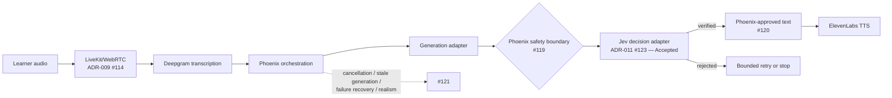

# Jev Prototype Design: Verified Dialogue and Educational Point Estimates

Status: **Accepted architecture as of 2026-09-21 — not implemented.** [ADR-011 (#123)](https://github.com/ChordanDev/proyectoMed/issues/123) and [ADR-012 (#124)](https://github.com/ChordanDev/proyectoMed/issues/124) are Accepted, and [Ticket 14 (#125)](https://github.com/ChordanDev/proyectoMed/issues/125) with children #126–#130 remains the implementation-planning graph. Acceptance authorizes architecture only. These records do not describe shipped Jev, estimate, schema, API, or UI behavior; do not activate pilot or production use; and do not select or approve a provider, accept privacy/ZDR/legal terms, establish clinical accuracy, authorize certification/pass-fail/readiness claims, or complete clinical pt-BR qualification.

## Decision summary

| Topic | Accepted architecture decision |
|---|---|
| Dialogue safety | Deterministic deny rules run first. Every non-template candidate must pass Jev before display or text-to-speech. |
| Approved reply | The only bypass is exact package/version-bound template text with deterministic applicability. Shortness, tone, or a model-provided ID never authorizes it. |
| Semantic rejection | Semantic refusal or low confidence means no delivery and permits at most one regeneration plus a complete recheck inside the turn deadline. |
| Technical failure | Jev timeout, malformed output, transport failure, or provider 5xx invalidates the attempt under existing policy. It never becomes `uncertain` and never produces fallback clinical text. |
| Evaluation split | TypeSafe outputs provide constrained classifications/probabilities. Code validates existing evidence IDs and applies authored rubric rules and decimal points. |
| Result | A complete numeric total exists only when every active criterion is assessed. Partial results show coverage and unresolved criteria without rescaling. |
| Claims | Educational estimate only: no pass/fail, official equivalence, certification, readiness claim, or published performance number. |
| Architecture | One shared Phoenix proxy/domain interface may host distinct generation, transcription, TTS, and decision-model adapters. Jev does not replace generation. |

## Current runtime and accepted architecture

| Area | Current evidence | Accepted, unimplemented change |
|---|---|---|
| Reply boundary | Closed #44 supplied the prior bounded-reply seam. Current modules remain top-level. | Add the Jev verification decision inside Phoenix while preserving #119–#121 ownership. |
| Evaluation | Closed #27 supplied the prior evaluator seam. The runtime still follows ADR-005 (#38) and has no global score. | Add four-state assessment and educational estimates under ADR-012; the accepted architecture is not implemented. |
| Voice | ADR-009 (#114) is **Accepted** for prototype LiveKit/WebRTC + Deepgram + ElevenLabs. Ticket 13 (#116) owns children #117–#121. | Integrate verification at the established Phoenix safety boundary; do not create another media or orchestration path. |
| Avatar | ADR-010 (#115) is **Proposed** and V3-only. | No dependency; excluded from this prototype. |
| Impressos | The #105–#108 dependency graph is unchanged. | Consume Impressos events only for criteria whose evidence requires those events. |
| Context governance | `Backend.StationAI`, `Backend.Evaluator`, and other top-level modules remain current code; no `Backend.Stations` module exists in the current source. | Migrate station operations behind the accepted `Backend.Stations` public context with internals under `backend/lib/backend/stations/`; this is an unimplemented target, not a shipped fact. |

## Dialogue safety contract

### Approved Generic Reply

An Approved Generic Reply is not “any short safe sentence.” It is one exact template whose identity and applicability are authored in a specific Station Package version.

A reply bypasses Jev only when all of these hold:

1. its text is byte-identical to the stored template;
2. the template belongs to the active `station_id` and package version;
3. code evaluates the authored applicability predicate to `true` from the current case state; and
4. the safe renderer emits the stored text without prefixes, suffixes, interpolation, or mixed content.

Length, brevity, language, sentiment, plausible tone, or a model-declared template ID never authorizes text. `"Estou bem"` is eligible only when the authored case state makes that exact statement non-contradictory. `"Não tenho alergias"` is a clinical claim, not a generic reply, and requires an authored revealable fact.

An approved template is not necessarily a clinical answer and is not a universal fallback. A deterministic known violation may route to a zero-clinical-content fallback only when that exact fallback template is approved for the violation and its applicability predicate passes. Otherwise code blocks the candidate and invalidates or ends the attempt according to the governing contract.

### Pipeline

1. **Run deny-only checks.** A known violation blocks the candidate. A clean result does not prove safety.
2. **Check exact approved-template identity and applicability.** If both pass, the safe renderer may emit the stored text.
3. **Send every other candidate to Jev.** Check groundedness, contradiction, disclosure timing, patient-role relevance, and prompt-injection evidence.
4. **Deliver only a verified result.** Rejected text never reaches the learner or ElevenLabs.

Learner turns may reach generation as untrusted evidence. A rejected or otherwise unverified patient candidate is not added to trusted conversation history or a regeneration prompt. Generation may receive package facts, untrusted learner evidence, and previously approved patient history; TTS receives only Phoenix-approved patient text.

### Outcome table

| Outcome | Delivery | Next action |
|---|---|---|
| Verified | Yes | Phoenix may display it and pass the approved text to TTS. |
| Semantic refusal | No | At most one regeneration and full verification within the total deadline; otherwise block/end under the contract. |
| Low confidence | No | Same bounded single-regeneration path as semantic refusal; never silently accept. |
| Deterministic known violation | No candidate delivery | Use an exact approved zero-clinical-content fallback only when its authored applicability passes; otherwise block/invalidate. |
| Jev timeout | No | Technical failure; invalidate the attempt under existing policy. No regeneration fallback or clinical text. |
| Malformed Jev output | No | Technical failure; invalidate the attempt. Do not convert it to `uncertain`. |
| Transport error or provider 5xx | No | Technical failure; invalidate the attempt. No partial feedback. |

The canonical patient reply `"Não tenho essa informação"` has clinical meaning: the package does not contain the requested fact. It may be used only under its exact authored applicability rule. It never masks infrastructure failure.

## Jev input and provider seams

Phoenix builds the gate request from trusted code and package data. Learner and model text are evidence fields, never instruction channels.

```json
{
  "stage_id": "verify-patient-reply",
  "request_id": "<per-candidate id>",
  "package_id": "<station_id>",
  "package_version": "<version>",
  "candidate": { "text": "<candidate>", "origin": "generation" },
  "latest_learner_turn": { "role": "learner", "seq": 42, "text": "<text>" },
  "conversation_context": [
    { "role": "learner", "seq": 1, "trust": "untrusted_evidence", "text": "<learner text>" },
    { "role": "patient", "seq": 2, "trust": "approved", "text": "<approved patient text>" }
  ],
  "allowed_facts": [
    { "fact_id": "<existing id>", "content": "<fact>", "disclosure_conditions": "<authored rule>" }
  ]
}
```

One shared Phoenix proxy/domain interface can host separate adapters for:

- patient-response generation;
- Deepgram transcription;
- ElevenLabs text-to-speech; and
- the Jev decision model.

Sharing an interface boundary does not collapse those capabilities into one adapter. Jev verifies generation output; it does not author or replace it. The accepted target public entry point is `Backend.Stations`, but migration from current top-level modules remains unimplemented governance work.

Provider selection, credentials, API limits, zero-data-retention terms, legal terms, and clinical pt-BR calibration are unresolved qualification gates. Vendor statements are inputs to review, not repository validation.

## Integration with real-time voice

ADR-009 (#114) already selects LiveKit/WebRTC + Deepgram + ElevenLabs for the prototype. Issues #119–#121 are integration boundaries, not blanket blockers for every Ticket 14 child. Jev integration must extend their flow without duplicating ownership:

- **#119:** no patient response exits Phoenix before the safety boundary passes it;
- **#120:** ElevenLabs receives only text Phoenix has approved; and
- **#121:** owns cancellation, stale generation, failure recovery, and realism, without absorbing media, UI, or orchestration concerns.

Ticket 14 children own only net-new Jev, content, evaluation, result, and qualification behavior. They reference the applicable #119–#121 contracts at integration time rather than recreating them or claiming their work.



## Evaluation contract

### Shared evidence

Evaluation uses the full ordered, immutable, role-labelled transcript. Rubric sections group criteria for presentation; they do not partition the transcript. A learner statement may support multiple criteria. Patient-role words never earn learner credit and may serve only as context or contradiction evidence.

When a criterion depends on an exam request or displayed result, evaluation also uses the relevant event from the unchanged #105–#108 Impressos graph, including source and channel identity. Criteria that do not depend on such events have no Impressos dependency.

### TypeSafe outputs and evidence identity

TypeSafe Choice/Noul-style primitives may return only constrained classifications or probabilities. They do not make model-authored evidence IDs trustworthy. Code supplies and validates the allowed classes, then selects only existing transcript or event IDs.

If the provider can return an ID from a code-supplied closed set, code verifies that the ID exists, has the expected role and provenance, and byte-matches the stored evidence. If the provider cannot return evidence IDs, deterministic span alignment is a separate algorithm and test surface. The design must not pretend that free prose or a generated identifier is aligned evidence.

Independent questions that inspect the same session state belong in one batched call, with the complete relevant role-labelled transcript shared across questions. A second call is allowed only for a genuine result dependency or a provider capacity limit—not to serially split topics.

### Deterministic rubric application

After classification, code—not Jev—applies authored rules:

- counts and thresholds;
- mandatory sub-actions;
- binary levels;
- sequence and time windows;
- first-N caps;
- veto conditions;
- spoken-action requirements, with Impressos evidence when relevant; and
- explicit author cancellation/exclusion.

Status is exactly `assessed | uncertain | not_observable | not_applicable`. A level (`inadequado | parcialmente_adequado | adequado`) and points exist only for `assessed`. A genuine omission on complete evidence may receive the authored zero-point level. Low confidence or missing modality is never silently scored zero. Arithmetic uses decimal or scaled-integer values, never binary floating point or probability-weighted points.

### Totals and illustrative fixture

A numeric `total` exists only when every active criterion is assessed. Otherwise `total` is `null`, with a scored subtotal, scored maximum, eligible maximum, and unresolved criteria. No partial result is rescaled.

This is an **illustrative fixture only**. It does not infer a real station maximum or publish an expected score:

```json
{
  "criteria": [
    {
      "id": "apresentacao",
      "status": "assessed",
      "level": "adequado",
      "points": 0.25,
      "max_points": 0.25,
      "evidence_ids": ["turn-3"]
    },
    {
      "id": "escuta-ativa",
      "status": "uncertain",
      "max_points": 1.0,
      "evidence_ids": []
    }
  ],
  "estimates": {
    "total": null,
    "scored_subtotal": 0.25,
    "scored_max": 0.25,
    "eligible_max": 1.25,
    "unresolved": [
      { "id": "escuta-ativa", "status": "uncertain" }
    ]
  }
}
```

A technical evaluation timeout, malformed response, transport error, or provider 5xx invalidates the attempt. It is not represented as criterion-level uncertainty.

## Result contract and learner claim

The current `met | omitted | uncertain` result remains authoritative until a versioned contract is implemented. The migration mechanism—a schema version or versioned endpoint—remains an implementation choice.

The accepted result architecture requires this pt-BR notice before and on the result screen once implemented:

> **Estimativa educacional gerada por IA. Não é nota oficial do Revalida. Não indica aprovação, reprovação, certificação ou prontidão para o exame.**

The UI must label fixtures as `exemplo — dados fictícios`, expose unresolved criteria, and avoid pass/fail, readiness, official-equivalence, and published-number claims.

## PEP structural reference

The design uses PEP only as a structural reference. It does not reproduce an official case, item body, answer, cutoff, station total, or medical recommendation.

The retained extraction notes cite the owner-supplied **PEP 2023/1 definitive edition**, filename `2023_1_PEP_publicacao.pdf` (55-page PDF): levels and decimal granularity on PDF pp. 4–5; count, order, and first-N rules on pp. 10–11; veto on p. 15; verbalization and Impressos-supported actions on p. 20; nonverbal criteria on pp. 24–25; and annulment on pp. 46–47. The filename, edition, and PDF page number must travel together in review citations.

The repository file is [`docs/revalida 25.1 pep_definitivo.pdf`](../revalida%2025.1%20pep_definitivo.pdf), a different edition with different pagination. It must not be cited as the source of the 2023/1 page references without a fresh page-level check. Original partner-authored station content remains required.

## ADR impact

| Artifact | Current runtime fact | Accepted architectural effect |
|---|---|---|
| ADR-002 (#35) | Accepted Station AI safety contract; current runtime remains unchanged. | [ADR-011 (#123)](https://github.com/ChordanDev/proyectoMed/issues/123), accepted on 2026-09-21, now architecturally extends or supersedes the relevant safety contract. Implementation remains pending. |
| ADR-005 (#38) | Accepted no-score rule; current runtime still has no global score. | [ADR-012 (#124)](https://github.com/ChordanDev/proyectoMed/issues/124), accepted on 2026-09-21, now architecturally supersedes the no-score rule only for estimates while preserving no certification, pass/fail, or readiness claim. Implementation remains pending. |
| ADR-009 (#114) | **Accepted** prototype LiveKit/WebRTC + Deepgram + ElevenLabs | Reused as the voice foundation; not reopened. |
| ADR-010 (#115) | **Proposed**, V3 only | Excluded from the Jev prototype. |
| ADR-008 (#104), #105–#108 | Accepted channel decision and unchanged Impressos DAG | Reused only when a criterion needs event evidence. |
| #27 and #44 | Closed prior evaluator and bounded-reply seams | Extended through new work; not reopened. |

Both ADRs are Accepted as architecture as of 2026-09-21. Acceptance changes the architectural rules but does not change runtime behavior or authorize pilot/production activation.

## Published Ticket 14 breakdown

[Ticket 14 (#125)](https://github.com/ChordanDev/proyectoMed/issues/125) is open with no labels and has exactly five native subissues, #126–#130. The architecture acceptance gate is resolved; #126 has no native blockers. Ticket 14 and all five children still have no readiness labels. The children own only net-new behavior:

| Issue | Scope and ownership | Mode | Exact native blockers |
|---|---|---|---|
| [#126](https://github.com/ChordanDev/proyectoMed/issues/126) | Package/schema and fictional fixtures: versioned schema, approved templates/applicability, disclosure conditions, PEP-shaped authored rubric, and explicitly fictional fixtures | AFK | None |
| [#127](https://github.com/ChordanDev/proyectoMed/issues/127) | Jev adapter/gate: gate adapter, bounded semantic retry, technical-failure taxonomy, and human approval of provider terms, privacy, legal, and ZDR evidence | HITL | #126 |
| [#128](https://github.com/ChordanDev/proyectoMed/issues/128) | Deterministic evaluation and estimates: owns evaluation Jev calls, validated evidence IDs, deterministic rules, exact decimal arithmetic, and coverage-aware totals. If gate and evaluation reuse one decision-adapter capability, this child consumes it from #127 without transferring evaluation-call ownership. | AFK | #126, #127 |
| [#129](https://github.com/ChordanDev/proyectoMed/issues/129) | Result contract and disclaimer: versioned API migration, unresolved coverage, pt-BR educational disclaimer, and fixture labels | HITL | #128 |
| [#130](https://github.com/ChordanDev/proyectoMed/issues/130) | Clinical authoring and qualification: original case re-authoring, provenance/rights review, and human approval of clinical pt-BR calibration and acceptance thresholds | HITL | #126, #127, #128, #129 |

These are the complete native blocker sets. The accepted voice boundaries #119–#121 remain integration references, not blanket blockers; Impressos #105–#108 remains relevant only to event-dependent criteria. The graph does not transfer media, UI orchestration, cancellation, stale-generation, failure-recovery, realism, or evaluation-call ownership.

Architecture acceptance is not approval to implement or activate pilot/production use. Provider terms/privacy/legal/ZDR evidence plus clinical pt-BR calibration and acceptance thresholds remain human qualification gates. No issue or document claims ready-for-agent approval, and the native blocker graph remains unchanged.

## Open implementation choices

- total turn deadline and bounded context-window values;
- schema-version field versus versioned endpoint;
- provider selection, credentials, limits, and evidence for the required human terms/privacy/legal/ZDR approval;
- clinical pt-BR calibration method and evidence for the required human qualification gate;
- whether validated sub-action details are public API fields or UI-only grouping; and
- deterministic span-alignment design if the selected provider cannot return code-supplied evidence IDs.

These choices do not reopen the accepted architecture; they belong to the named child issue gates and separately authorized runtime planning.

## Official TypeSafe sources

Retrieved vendor documentation used to shape the architecture:

- [TypeSafe primitives](https://docs.typesafe.ai/primitives.md)
- [Confidence semantics](https://docs.typesafe.ai/confidence.md)
- [Legal documentation](https://docs.typesafe.ai/legal.md)
- [Introducing System One Models and Jev](https://typesafe.ai/blog/introducing-system-one-models-and-jev)

These are vendor claims, not repository validation. Zero-data-retention, legal terms, API behavior, clinical pt-BR calibration, and safety accuracy remain pending evidence and approval.

## Repository references

- `CONTEXT.md` — current runtime terms plus accepted, unimplemented architecture terms.
- `SPEC_MVP.md` — current contract plus the accepted, unimplemented extension.
- [#123 ADR-011](https://github.com/ChordanDev/proyectoMed/issues/123); [#124 ADR-012](https://github.com/ChordanDev/proyectoMed/issues/124); [#125 Ticket 14](https://github.com/ChordanDev/proyectoMed/issues/125) and children [#126](https://github.com/ChordanDev/proyectoMed/issues/126)–[#130](https://github.com/ChordanDev/proyectoMed/issues/130).
- #114 ADR-009; #115 ADR-010; #116 Ticket 13 and children #117–#121.
- #105–#108 Impressos DAG; closed seams #27 and #44.
